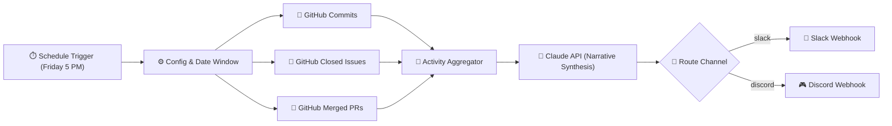

# Automated Weekly Dev Summary: n8n + Claude API 🤖📊

> Fully autonomous n8n workflow that aggregates weekly GitHub repository activity (commits, closed issues, merged pull requests) and leverages **Anthropic's Claude API** to generate an executive engineering narrative summary delivered directly to Slack or Discord.

---

## 🌟 Key Features

- **Automated Weekly Cadence:** Runs autonomously via cron trigger every Friday at 17:00 (5:00 PM).
- **Parallel GitHub Aggregation:** Concurrently queries GitHub REST API for:
  - Merged Pull Requests (with authors and timestamps).
  - Closed Issues (filtering out PR issue duplicates).
  - Commit history within the configurable lookback window.
- **Claude Narrative Engine:** Employs Claude (`claude-sonnet-4-20250514` / `claude-3-7-sonnet`) to generate structured, actionable engineering reports.
- **Bilingual Support:** Configurable between English (`EN`) and French (`FR`).
- **Multi-Channel Dispatch:** Dynamic routing to **Slack Webhooks** or **Discord Webhooks**.

---

## 🚀 Setup Instructions (in 5 Steps)

### Step 1: Import the Workflow
1. Open your n8n dashboard (cloud or self-hosted).
2. Go to **Workflows** → Click **Add Workflow** (or press `Ctrl+O`).
3. Click the **three dots (⋮)** in the top right → **Import from File...**
4. Select [`workflow.json`](workflow.json).

### Step 2: Configure Environment Variables / Credentials
In your n8n instance settings (or `.env` file), configure your Claude API key:
```env
ANTHROPIC_API_KEY=sk-ant-api03-...
```
*(Optionally configure `GITHUB_TOKEN` if monitoring large private repositories to increase API rate limits).*

### Step 3: Set Your Workflow Variables
Double-click the **Workflow Configuration** node and set:
- `GITHUB_OWNER`: GitHub organization or user (e.g. `facebook`)
- `GITHUB_REPO`: Repository name (e.g. `react`)
- `SUMMARY_LANGUAGE`: `EN` for English, or `FR` for French
- `DELIVERY_CHANNEL`: `slack` or `discord`
- `SLACK_WEBHOOK_URL` / `DISCORD_WEBHOOK_URL`: Your webhook endpoint

### Step 4: Test Run
Click **Test Workflow** in the bottom bar of n8n to execute an instant test run and inspect the parsed output.

### Step 5: Activate
Toggle the **Active** switch at the top right to enable the Friday 5:00 PM schedule.

---

## 📋 Architecture & Data Flow



---

## 📝 Example Output

### English (`EN`):
> **📢 Weekly Engineering Summary: acme/core-platform (2026-10-10 to 2026-10-17)**
> 
> ### 📊 Executive Summary & Velocity
> The engineering team achieved notable momentum this week with **14 merged PRs**, **8 resolved issues**, and **42 commits**. Focus remained centered on API resilience and cross-chain settlement latency.
> 
> ### 🚀 Key Features & Merged PRs
> - **#142 CCTP Message Decoder Hardening:** Enforced strict V2 header checks to eliminate misrouted mints.
> - **#138 Soroban RPC Circuit Breaker:** Implemented exponential backoff for transient 503 RPC dips.
> 
> ### 🛡️ Critical Bugfixes
> - Fixed race condition between dispute window verification and fund challenge timeouts (#119).
> - Corrected precision truncation on high-decimal USDC token swaps (#124).
> 
> ### 💡 Engineering Impact & Focus for Next Week
> Core test coverage increased to **91.4%**. Next sprint will prioritize the launch of our automated self-healing transaction watchdog.

---

## 🔒 Security Best Practices
- API keys are injected via n8n credentials or environment variables (`$env.ANTHROPIC_API_KEY`), never hard-coded in the workflow JSON.
- GitHub read access requires only public repo access (or `repo:read` for private internal repositories).
